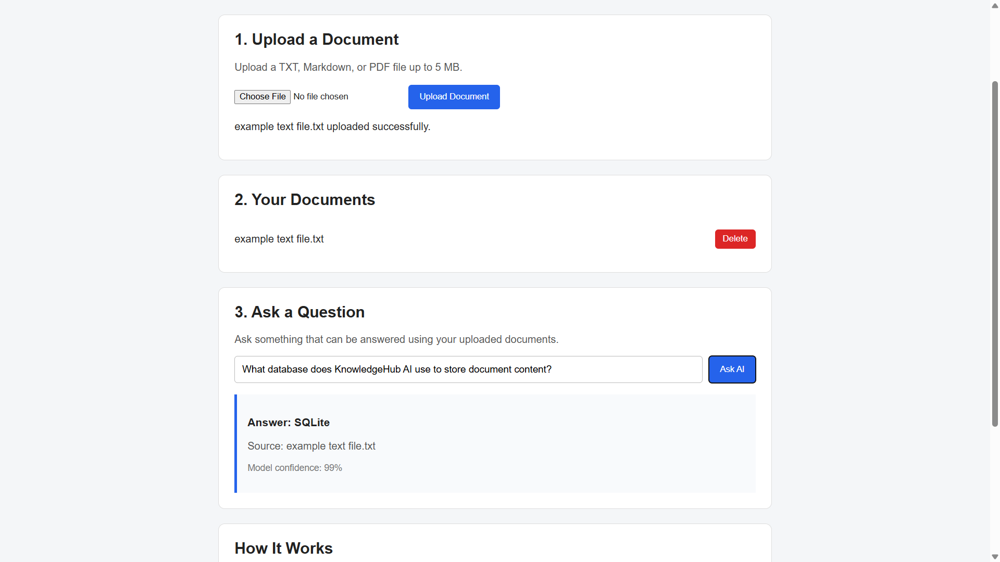

# KnowledgeHub AI

KnowledgeHub AI is a document question-answering application built with Python and FastAPI.

Users can upload TXT, Markdown, or PDF documents and ask questions about their content. The application finds the most relevant part of the uploaded documents and uses a pretrained DistilBERT model to extract an answer.

## Demo

## Features

- Upload TXT, Markdown, and PDF documents
- Store document text using SQLite
- View and delete uploaded documents
- Ask questions about uploaded content
- Search document sections using TF-IDF and cosine similarity
- Generate answers using DistilBERT
- Display the source document used for each answer
- Basic file and question validation
- Automated tests with pytest
- Simple responsive web interface

## Tech Stack

- Python
- FastAPI
- SQLite
- Hugging Face Transformers
- DistilBERT
- scikit-learn
- PyTorch
- HTML
- CSS
- JavaScript
- pytest

## How It Works

1. The user uploads a document.
2. The document text is extracted and stored in SQLite.
3. The text is split into smaller chunks.
4. TF-IDF and cosine similarity find the chunk most related to the question.
5. DistilBERT reads the selected chunk and extracts an answer.
6. The answer and source document are displayed to the user.

## Project Structure

knowledgehub-ai/
- main.py
- database.py
- ai_tools.py
- requirements.txt
- pytest.ini
- static/
  - index.html
  - style.css
  - app.js
- tests/
  - test_ai_tools.py

## Running the Project

Create and activate a virtual environment:

    py -m venv .venv
    .\.venv\Scripts\Activate.ps1

Install dependencies:

    pip install -r requirements.txt

Run the application:

    uvicorn main:app --reload

Open:

    http://127.0.0.1:8000

FastAPI documentation:

    http://127.0.0.1:8000/docs

## Running Tests

    pytest -v

## Limitations

- The application only answers questions using uploaded documents.
- Scanned PDFs without readable text are not supported.
- The current version uses a local SQLite database.
- DistilBERT extracts answers rather than generating long conversational responses.

## Future Improvements

- Better document chunking
- Multiple source citations
- Search history
- Additional document formats
- More advanced semantic search

## Purpose

This project was created to practice AI-based document processing, REST APIs, databases, automated testing, and software development workflow.
